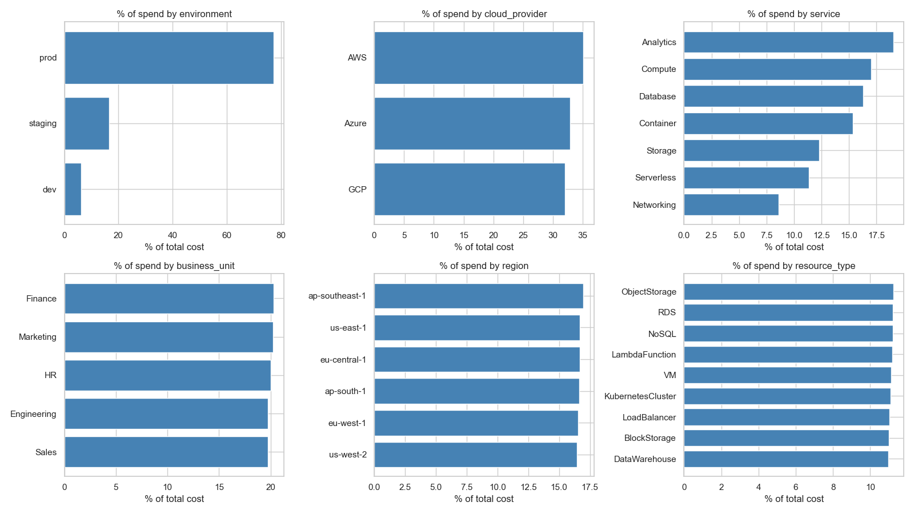
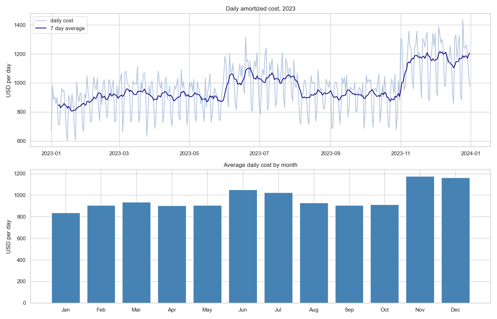
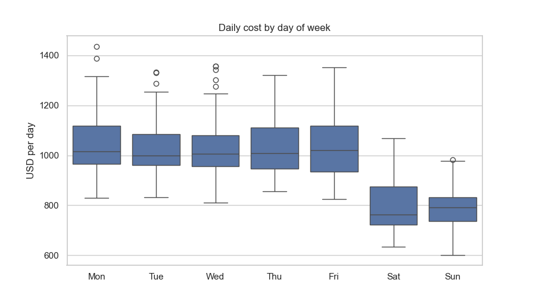
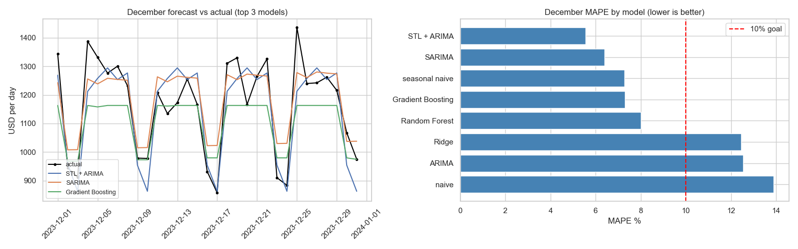
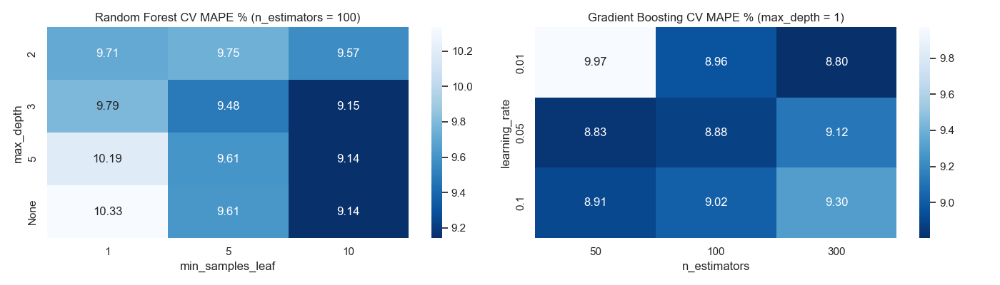
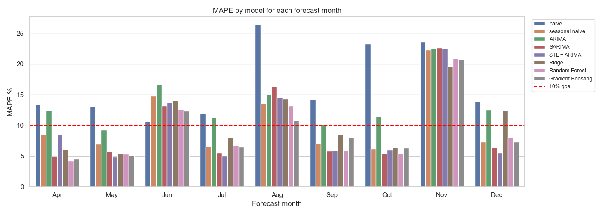
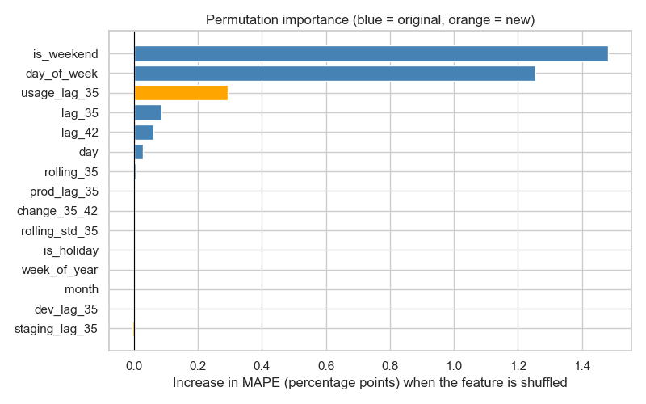
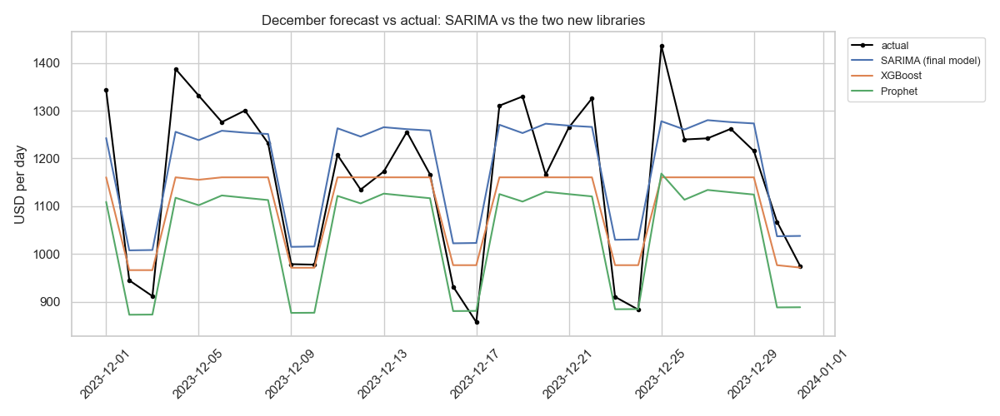
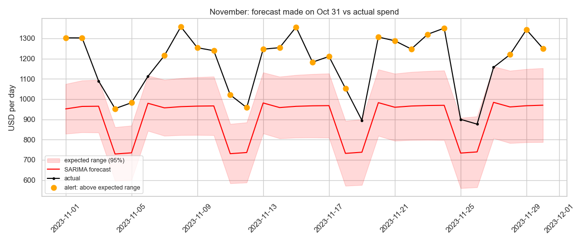
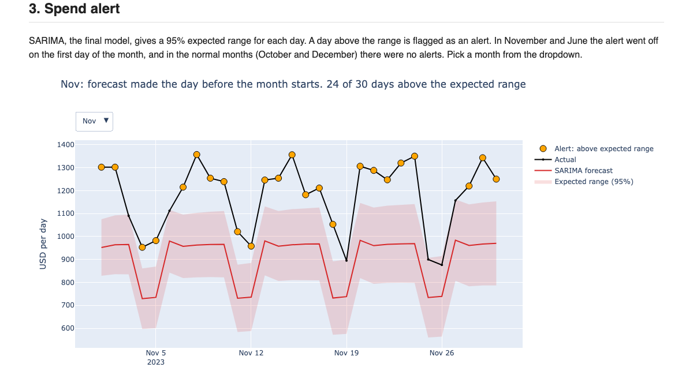

# Cloud Cost Optimization and Expected Spend Forecasting

Notebooks: [Part 1: EDA and statistics](1_cloud_cost_eda.ipynb) | [Part 2: Modeling and recommendations](2_cloud_cost_modeling.ipynb) | [Part 3: Dashboard](3_dashboard.ipynb)

**[Interactive dashboard](https://gowdilyan.github.io/cloud_cost_optimization/)**: explore the daily spend, the forecasts, the spend alert and a savings calculator in the browser.

#### Contents

1. [Executive summary](#executive-summary): the short version of the problem, results and recommendations
2. [Rationale](#rationale): why forecasting cloud spend matters
3. [Research question](#research-question)
4. [Data sources](#data-sources): the dataset and the target
   - [Changes since the Module 16 proposal](#changes-since-the-module-16-proposal)
5. [Methodology](#methodology): cleaning, EDA, statistical tests, models, tuning and the evaluation metric
6. [Results](#results)
   - [Key findings from the EDA](#key-findings-from-the-eda)
   - [December test](#december-test): all models compared on one month
   - [Hyperparameter tuning](#hyperparameter-tuning): grid search results, default vs tuned, random search
   - [Nine-month backtest](#nine-month-backtest): all models compared from April to December
   - [Feature engineering and selection](#feature-engineering-and-selection): new features, permutation importance, SFS and Lasso
   - [Libraries outside the course](#libraries-outside-the-course): XGBoost and Prophet
   - [Final model](#final-model): why SARIMA was chosen
   - [Spend alert](#spend-alert): catching sudden jumps in spend
7. [Interactive dashboard](#interactive-dashboard): the web page and what it shows
8. [Recommendations](#recommendations): actions for a non-technical audience
9. [Next steps](#next-steps)
10. [Outline of project](#outline-of-project): notebooks, folder structure and how to run

#### Executive summary

Most teams only see their cloud bill once a month, so when spend goes up it's usually noticed weeks later. This project uses one year (2023) of daily cloud billing data to see if past spend can forecast next month's cost, and if that forecast can give an early warning when spend goes higher than normal.

The EDA shows two main patterns. **Weekends are about 24% cheaper than weekdays**, and instead of growing slowly, **spend jumps up or down in steps** (up 16% in June, down 10% in August and up 29% in November).

Six models from the course and two popular libraries from outside it (XGBoost and Prophet) were compared against two simple baselines. The final model, **SARIMA, was off by about 5.7% per day in normal months**, which is under the goal of 10%, and its December total was only 1.9% off. More tuning, more features and the two extra libraries didn't beat it. None of the models could predict the jumps, since there's nothing in past spend that shows a jump is coming. But when the forecast's 95% range was used as an alert, **it flagged the June and November jumps on the first day** and didn't flag anything in the normal months that were checked.

The recommendations are to use the forecast for monthly budgeting, set up a daily alert based on the forecast range, focus cost reviews on prod (77% of the spend), and scale down dev and staging on weekends. The full list is in [Recommendations](#recommendations), and the results can also be explored on the [interactive dashboard](https://gowdilyan.github.io/cloud_cost_optimization/).

#### Rationale

Cloud costs change every day, and a new workload or a test environment someone forgot to turn off can add a lot to the bill before anyone notices. Finance needs a good estimate for next month's budget, and engineering needs to know early when spend starts going up so they can look into it. A forecast of the expected spend can help both.

#### Research question

How can an organization use historical time series analysis to build an accurate forecasting model for its expected cloud infrastructure costs?

#### Data sources

The data comes from the [Cloud Budget Dataset on Kaggle](https://www.kaggle.com/datasets/rasikaekanayakadevlk/cloud-budget-dataset), specifically the main file [`cloud_budget_2023_dataset.csv`](data/cloud_budget_2023_dataset.csv) (in the `data` folder). It has 54,750 rows and 40 columns, with 150 billing line items per day for all of 2023 across AWS, Azure and GCP. Total spend for the year is about $354,000, or about $29,500 a month. The target is `amortized_cost`, which is the cost after discounts, summed per day.

##### Changes since the Module 16 proposal

- The proposal mentioned CPU, RAM and storage utilization as predictors, but the dataset doesn't have those columns. The only usage metric is `usage_quantity`.
- The proposal expected daily and weekly cycles. The data is daily, so there's no within-day cycle, and only the weekly season turned out to matter.
- The proposal also expected higher spend at the end of the month. This was tested and not found.
- Holiday trends were expected too. Weekends are clearly cheaper, but holidays aren't. The holiday Mondays on long weekends cost about the same as normal Mondays, and Thanksgiving and Christmas cost about the same as or more than a normal weekday. With one year of data each holiday only happens once, so this couldn't be tested properly, but it looks like the drop only follows Saturday and Sunday on the calendar, not days off.
- The budget and anomaly columns weren't useful (budget status is always "under" and no anomalies are flagged), so the forecast is compared to actual spend instead of the budget.
- The proposal planned to use MSTL and SARIMA. The final version compares eight models plus two baselines, and tests them on nine months instead of one.
- The idea of flagging spend above the forecast turned into the alert described in the results.
- The tuning is now shown in more detail: the full grid search results, default vs tuned settings, a random search, and a check that the lowest AIC also gives a good SARIMA forecast.
- Eight more features were tried, along with feature selection (permutation importance, `SequentialFeatureSelector` and Lasso). They didn't help, so the original features were kept.
- Two libraries that weren't in the course were added, XGBoost and Prophet.
- The results can also be explored on an interactive dashboard, built with Plotly and published with GitHub Pages.
- The dataset is synthetic.

#### Methodology

The [first notebook](1_cloud_cost_eda.ipynb) cleans the data (missing values, duplicates, missing days, and columns that have only one value) and looks at outliers with the IQR rule. The outliers were real prod costs, and the high days were part of the November/December increase, so they were kept. The EDA covers spend by category, the distributions, usage vs cost, correlations, cost over time and the weekly pattern. The time series itself is checked with an [MSTL decomposition](https://www.statsmodels.org/stable/generated/statsmodels.tsa.seasonal.MSTL.html), the [ADF test](https://www.statsmodels.org/stable/generated/statsmodels.tsa.stattools.adfuller.html) for stationarity and ACF/PACF plots. Finally, [t-tests](https://docs.scipy.org/doc/scipy/reference/generated/scipy.stats.ttest_ind.html) check whether the patterns are real: weekday vs weekend, the weekend drop in each environment, October vs November, and the end of the month vs the rest of the month.

The [second notebook](2_cloud_cost_modeling.ipynb) builds the models. The two baselines are very simple: one repeats the last day and the other repeats the last week. Three time series models come from Module 10: [ARIMA](https://www.statsmodels.org/stable/generated/statsmodels.tsa.arima.model.ARIMA.html), [SARIMA](https://www.statsmodels.org/stable/generated/statsmodels.tsa.statespace.sarimax.SARIMAX.html) (ARIMA with a weekly season) and [STL + ARIMA](https://www.statsmodels.org/stable/generated/statsmodels.tsa.forecasting.stl.STLForecast.html) (which removes the weekly pattern, forecasts the rest with ARIMA and adds the pattern back). For each one, a range of settings was tried and the one with the lowest AIC was kept. Three regression models use day of week, month and the cost from 5 and 6 weeks earlier as features: Ridge regression, Random Forest and Gradient Boosting. These were tuned with [`GridSearchCV`](https://scikit-learn.org/stable/modules/generated/sklearn.model_selection.GridSearchCV.html), using [`TimeSeriesSplit`](https://scikit-learn.org/stable/modules/generated/sklearn.model_selection.TimeSeriesSplit.html) so the model is always trained on earlier days and checked on later ones. The grids cover `alpha` for Ridge (5 values), tree depth, leaf size and number of trees for Random Forest (24 combinations), and learning rate, depth and number of trees for Gradient Boosting (27 combinations). A wider [`RandomizedSearchCV`](https://scikit-learn.org/stable/modules/generated/sklearn.model_selection.RandomizedSearchCV.html) on Gradient Boosting (50 combinations) checks that the grid didn't miss a better area.

Eight more features were then tested: week of the year, a holiday flag, the spread and the change of the lagged cost, the cost of each environment 35 days earlier, and the usage 35 days earlier. Every feature had to be known at least 31 days ahead, since the whole month is forecast at once. To see which features are worth keeping, the notebook uses [permutation importance](https://scikit-learn.org/stable/modules/permutation_importance.html), [`SequentialFeatureSelector`](https://scikit-learn.org/stable/modules/generated/sklearn.feature_selection.SequentialFeatureSelector.html) and [Lasso](https://scikit-learn.org/stable/modules/generated/sklearn.linear_model.Lasso.html).

Two libraries from outside the course were also tested the same way. [XGBoost](https://xgboost.readthedocs.io/) is a widely used gradient boosting library, tuned with the same `GridSearchCV` and features as the other regression models. [Prophet](https://facebook.github.io/prophet/) is Meta's forecasting library for daily business data, with a weekly season, holiday effects and a trend that can bend where the data changes. Its main setting (how easily the trend bends) was tuned on the last 30 days before each forecast month.

To evaluate the models, each one was first trained on January to November and tested on December. Since one month could just be lucky, the whole process (including the tuning) was then repeated for every month from April to December, each time only using the data before that month.

The main metric is [MAPE](https://scikit-learn.org/stable/modules/generated/sklearn.metrics.mean_absolute_percentage_error.html) (mean absolute percentage error), which is the average percent the forecast is off by each day. It was picked because it's easy to explain to anyone and it doesn't depend on how big the bill is. MAPE can be a problem when actual values are close to zero, but the lowest daily cost here is about $600, so that isn't an issue. MAE in dollars and the error on the monthly total are reported too.

#### Results

##### Key findings from the EDA

Prod makes up about 77% of the spend, staging 17% and dev 6%. Provider, region and business unit are split almost evenly.



Spend doesn't grow smoothly. It went up 16% in June, came back down 10% in August and jumped 29% in November. A t-test shows the November jump is real and not just noise (p < 0.001).



Weekends cost about $246 a day less than weekdays ($796 vs $1,042), and this difference is also significant (p < 0.001). Dev only drops about 20% on weekends, compared to about 24% for staging and prod, which is a bit surprising since dev is the environment most expected to be idle on a weekend. There's no end-of-month effect (p = 0.59).



##### December test

For the first test, every model was trained on January to November and used to forecast December:

| Model | MAPE (daily error) | MAE | Error on the December total |
|---|---|---|---|
| STL + ARIMA | 5.6% | $66 | -1.4% |
| SARIMA | 6.4% | $71 | +1.9% |
| Seasonal naive | 7.3% | $87 | -1.5% |
| Gradient Boosting | 7.3% | $89 | -5.2% |
| Random Forest | 8.0% | $88 | -4.9% |
| Ridge | 12.5% | $152 | -13.1% |
| ARIMA | 12.5% | $137 | -0.4% |
| Naive | 13.9% | $141 | +7.6% |



##### Hyperparameter tuning

The tuning was done on January to November only, and December was only used to report the result. The settings matter, but only by about 1 to 1.5 percentage points. For Random Forest, leaf size matters the most: with at least 10 days per leaf the trees stop memorizing single days. For Gradient Boosting, a small learning rate needs more trees, which is the usual trade-off.



| Model | Default CV MAPE | Tuned CV MAPE | Default December MAPE | Tuned December MAPE |
|---|---|---|---|---|
| Ridge | 10.9% | 9.4% | 12.7% | 12.5% |
| Random Forest | 10.3% | 9.1% | 5.5% | 8.0% |
| Gradient Boosting | 9.7% | 8.8% | 6.8% | 7.3% |

Tuning beat the default settings on cross-validation for all three models. The surprise was December, where the default trees actually did better. The default trees are more detailed, so they most likely follow November closely, and December happened to stay at November's level. The tuned models are simpler (Random Forest needs at least 10 days per leaf, and Gradient Boosting uses trees with a single split), so they average November with the cheaper months before it.

Switching to the defaults would mean picking settings based on the test month, so the tuned settings were kept, and the models were compared on the nine-month backtest below instead of on December alone. The variation between cross-validation folds (about 3 percentage points) is also bigger than the gaps between the top settings, so the top few settings of each model are basically tied.

The random search over wider ranges didn't beat the grid on cross-validation (9.0% vs 8.8%), so the grid already covered the good area. For SARIMA, which was tuned by AIC, the top 5 orders all scored between 6.37% and 6.46% in December, so picking the lowest AIC was a safe choice.

##### Nine-month backtest

The test was then repeated for each month from April to December. In June, August and November the spend level shifted, and every model missed by 10% to 26% in those months. In the other six months the best models were off by about 6% or less.



| Model | Normal months (Apr, May, Jul, Sep, Oct, Dec) | Shift months (Jun, Aug, Nov) | All 9 months |
|---|---|---|---|
| SARIMA | 5.7% | 17.4% | 9.6% |
| Random Forest | 6.0% | 15.6% | 9.2% |
| STL + ARIMA | 6.0% | 17.0% | 9.7% |
| Gradient Boosting | 6.3% | 14.6% | 9.1% |
| Seasonal naive | 7.1% | 16.9% | 10.4% |
| Ridge | 7.8% | 16.0% | 10.6% |
| ARIMA | 11.2% | 18.1% | 13.5% |
| Naive | 15.0% | 20.2% | 16.7% |

The weekly pattern turned out to be the most important thing for the models to capture. ARIMA, which doesn't have a weekly season, was barely better than the naive forecast. The top four models were within less than one percentage point of each other in normal months, so the small differences probably don't mean much. The tree models did a bit better in the shift months but were less consistent in normal months (in December they were about 5% too low). With only one year of data, the regression models likely didn't have enough history to learn more than the time series models.

##### Feature engineering and selection

The eight new features didn't improve the forecast. With all 15 features, the cross-validation error went up slightly for both tree models, and in the backtest Gradient Boosting did a bit worse than with the original 7 features in 8 of the 9 months. The permutation importance shows why: the weekend flag and day of week do almost all the work, usage from 35 days earlier is the only new feature that helps a little, and the environment lags, the holiday flag and the trend features score close to zero. The holiday result matches the EDA, where holidays didn't cost less than normal days.



Both selection methods kept very few features. `SequentialFeatureSelector` kept only day of week (plus the 35-day lag for Random Forest), and Lasso kept only the weekend flag and dropped the other 19 columns. To test the selected features fairly, the selection was repeated inside each backtest month using only earlier data:

| Gradient Boosting features | Normal months | Shift months | All 9 months |
|---|---|---|---|
| Original 7 features | 6.3% | 14.6% | 9.1% |
| All 15 features | 6.5% | 15.4% | 9.5% |
| Features picked by SFS each month | 7.2% | 14.9% | 9.8% |

The selected features did a bit better in five of the six normal months, but missed December by 17%. With only calendar features, the model has nothing that tells it the current level of spend, so it forecast about $958 a day when December stayed at November's higher level of $1,163. The picked features also changed almost every month. So the original 7 features were kept, since the lag features protect the forecast when the spending level changes.

##### Libraries outside the course

| Model | December MAPE | Normal months | Shift months | All 9 months |
|---|---|---|---|---|
| SARIMA (final model) | 6.4% | 5.7% | 17.4% | 9.6% |
| XGBoost | 7.4% | 6.1% | 14.6% | 9.0% |
| Gradient Boosting | 7.3% | 6.3% | 14.6% | 9.1% |
| Prophet | 9.8% | 6.0% | 17.6% | 9.9% |



XGBoost ended up almost identical to Gradient Boosting. The grid search picked the same settings, and it scored within about 0.15 percentage points of it in every test. It has the lowest nine-month average of all the models, but that lead comes from the shift months, where every model is off by about 15% to 20% on average. In normal months SARIMA is still more accurate.

Prophet was close to the best models in normal months, but it struggled with the level shifts and was 10% too low on the December total. Its trend changepoints can only react once a shift is already in the history, so like every other model it can't see a jump coming. Neither library found anything the course models had missed, so SARIMA stays the final model.

##### Final model

**SARIMA was chosen as the final model.** It had the lowest error in normal months and was never worse than 6.4% in any of them, its residuals look like random noise, and it gives a 95% range for each day, which is used for the alert below. XGBoost had a slightly better nine-month average, but only because of the shift months, and it doesn't give a range that can be used for an alert.

##### Spend alert

Since no model could predict the jumps, the next question was whether the forecast could at least catch them quickly. SARIMA was trained on the data before each month, and the days where actual spend went above the 95% range were counted. In November, 24 of the 30 days were above the range, starting on November 1. In June it was 16 of 30 days, also starting on the first day. In October and December, which were normal months, no days went above the range.



#### Interactive dashboard

The results are also on an [interactive web page](https://gowdilyan.github.io/cloud_cost_optimization/), built with Plotly in the [third notebook](3_dashboard.ipynb) and published with GitHub Pages. It has six parts:

1. Daily spend for the whole year, as a total or split by environment or provider, with weekends shaded and a slider to zoom in.
2. Forecast vs actual for any month from April to December, with each model's daily forecast and error. Models can be turned on and off in the legend.
3. The spend alert for June, October, November and December, with the 95% expected range and the flagged days.
4. A heatmap of every model's error in every month.
5. A savings calculator with two sliders, one for how much dev and staging weekend spend is scaled down and one for the savings from a prod cost review.
6. The grid search results for Random Forest and Gradient Boosting.

The forecasts on the page come from the same backtest as the second notebook, and the scores match.



#### Recommendations

1. Use the forecast to set next month's budget, and refit it every month with the latest data. It only takes a few seconds to run.
2. Set up a daily alert for when spend goes above the forecast range. If that happens two days in a row, check with the teams what changed (a new launch, a migration, a new workload) and update the budget then, instead of waiting for the bill. In November this would have given almost a month of warning.
3. Focus cost reviews on prod. Saving 5% in prod is worth about $13,700 a year, which is more than what dev costs on all the weekends combined ($5,300).
4. Scale down dev and staging on weekends. This could save up to about $19,000 a year, or about 5% of the total. That's the maximum though, since some non-prod work probably does need to run on weekends.
5. There's no need to plan for higher spend at the end of the month, since the data doesn't show it.

Since the dataset is synthetic and only covers one year, these numbers should be checked on real billing data first.

#### Next steps

- Try the same approach on real billing data with more than one year of history, so the models can learn yearly patterns like the November increase.
- Add known events like launches or migrations as features, so planned jumps can be forecast instead of only caught after they happen.
- Forecast prod, staging and dev separately. Each one has a different weekend pattern, and separate alerts would show where a change came from.
- Try different alert ranges (for example 80% instead of 95%) and see how many real changes and false alarms each one gives.
- Usage from 35 days earlier was the only new feature that helped a little. With more history it might be worth adding to the regression models, or as an extra input to SARIMA or Prophet.

#### Outline of project

- [Part 1: Data cleaning, EDA and inferential statistics](https://github.com/gowdilyan/cloud_cost_optimization/blob/main/1_cloud_cost_eda.ipynb)
- [Part 2: Modeling, evaluation, spend alert and recommendations](https://github.com/gowdilyan/cloud_cost_optimization/blob/main/2_cloud_cost_modeling.ipynb)
- [Part 3: Interactive dashboard](https://github.com/gowdilyan/cloud_cost_optimization/blob/main/3_dashboard.ipynb), which builds the [web page](https://gowdilyan.github.io/cloud_cost_optimization/)

Repository structure:

```
├── data
│   └── cloud_budget_2023_dataset.csv
├── docs
│   └── index.html
├── images
├── 1_cloud_cost_eda.ipynb
├── 2_cloud_cost_modeling.ipynb
├── 3_dashboard.ipynb
├── requirements.txt
└── README.md
```

To run the project, clone the repository, install the packages with `pip install -r requirements.txt` (see [requirements.txt](requirements.txt)), and run the three notebooks in order. The first two save their charts to the [`images`](images) folder, and the third saves the web page to [`docs/index.html`](docs/index.html), which can also be opened directly in a browser. The second notebook takes about 6 minutes, mostly because of the nine month test and the feature selection check, and the third takes about 3 minutes.

Packages used: pandas, numpy, matplotlib, seaborn, scipy, statsmodels, scikit-learn, xgboost, prophet and plotly.
